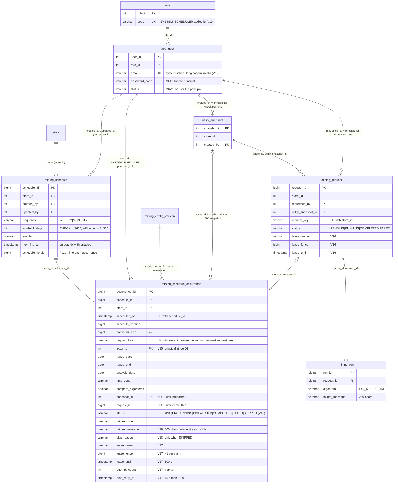

# F05 Scheduled Mining — database schema V14–V19

Reference for the tables behind scheduled Mining after Flyway **V18** and **V19** (decisions D6, D7, D9). Written from `SHOW CREATE TABLE` on a fresh MySQL 8.4.13 schema migrated by V1–V19, not from memory. The editable ERD is [`docs/diagrams/09-f05-scheduler-erd-v14-v19.mmd`](../diagrams/09-f05-scheduler-erd-v14-v19.mmd) (Mermaid text, same convention as `04-logical-erd-v1-v11.mmd`); a copy is embedded below so GitHub renders it. The existing Draw.io ERDs (F02 v3, F03 v4) and the 27-page UML pack are **not** changed by this document.

Migration review and the compatibility/roll-forward plan: [F05_V18_V19_SCHEMA_ROLLFORWARD_2026-11-02.md](../reports/F05_V18_V19_SCHEMA_ROLLFORWARD_2026-11-02.md).

## Migration map

| Version | File | Adds | Decision |
|---|---|---|---|
| V14 | `V14__scheduled_mining.sql` | `mining_schedule`, `mining_schedule_occurrence`, `ix_mining_schedule_due` | – |
| V15 | `V15__freeze_scheduled_occurrence_context.sql` | `actor_id`, `range_start/end`, `analysis_date`, `time_zone`, `compare_algorithms` (all nullable), `fk_occurrence_actor` | – |
| V16 | `V16__mining_request_leases.sql` | `mining_request.lease_owner/lease_fence/lease_until`, `ix_mining_dispatch` | – |
| V17 | `V17__mining_occurrence_recovery.sql` | occurrence `lease_owner/lease_fence/lease_until/attempt_count/next_retry_at`, `ix_occurrence_recovery` | – |
| **V18** | `V18__scheduler_skipped_status_and_failure_visibility.sql` | status `SKIPPED` (replaces `ck_occurrence_status`), `skip_reason VARCHAR(60)`, `failure_message VARCHAR(500)`, `ck_occurrence_skip_reason` | D6, D7 |
| **V19** | `V19__system_scheduler_principal.sql` | role `SYSTEM_SCHEDULER`, one `app_user` row (`system-scheduler@paspm.invalid`, `INACTIVE`, no password) | D9 |

V1–V17 are byte-identical to `origin/dev` `5c9d3dc` (`git diff origin/dev HEAD -- src/main/resources/db/migration` lists only V18 and V19). Flyway history checksums of V1–V17 are unchanged after the upgrade (asserted in `MiningMigrationMySqlTest` and the verification script).

## ERD (copy of `09-f05-scheduler-erd-v14-v19.mmd`)

## `mining_schedule_occurrence` — the table V18 changes

| Column | Type | Null | Meaning |
|---|---|---|---|
| `occurrence_id` | BIGINT PK | no | |
| `schedule_id`, `store_id` | BIGINT, INT | no | composite FK `(store_id, schedule_id)` → `mining_schedule`; the Store is carried so every child reference is Store-scoped |
| `scheduled_at` | TIMESTAMP | no | the logical fire time (UTC instant). **`UNIQUE (schedule_id, scheduled_at)`** — a fire time can exist once, as `SKIPPED` or as a run |
| `schedule_version`, `config_version` | BIGINT | no | versions **frozen at reservation** (D8). `config_version` FK → `mining_config_version` |
| `request_key` | VARCHAR(36) | no | `UUID(name-based, "PASPM-SCHEDULE-V1|<scheduleId>|<instant>")`; **`UNIQUE (store_id, request_key)`**; the Mining Request is created with this same key, and `mining_request` has `UNIQUE (store_id, request_key)`, so a second request for one occurrence cannot be committed |
| `actor_id` | INT FK → `app_user` | yes | executor. Set at reservation to the scheduler principal (D9). `NULL` for `SKIPPED` and for pre-V15 rows |
| `range_start`, `range_end`, `analysis_date`, `time_zone`, `compare_algorithms` | DATE ×3, VARCHAR(100), BOOLEAN | yes (V15) | the immutable execution context. `NULL` for `SKIPPED` and pre-V15 rows (never invented) |
| `snapshot_id` | INT | yes | composite FK `(store_id, snapshot_id)` → `utility_snapshot`; the fresh F03 snapshot, set inside the preparation transaction |
| `request_id` | BIGINT | yes | composite FK `(store_id, request_id)` → `mining_request`; set in the same transaction as the request insert |
| `status` | VARCHAR(20) | no | **V18** `CHECK IN ('PENDING','PROCESSING','DISPATCHED','COMPLETED','FAILED','SKIPPED')` |
| `failure_code` | VARCHAR(40) | yes | `HTTP_<n>` for non-retryable causes, `PROCESSING_FAILED` (unexpected error), `RETRYABLE_FAILURE` between attempts, `RETRY_EXHAUSTED`, `MINING_FAILED` (request failed) |
| `failure_message` | VARCHAR(500) | yes | **V18 (D7)** curated, administrator-visible final cause. Clipped to 500 characters by the writer; the only source copied in (`mining_run.failure_message`) is 250 characters |
| `skip_reason` | VARCHAR(60) | yes | **V18 (D6)** `MISSED_SUPERSEDED_BY_LATER_OCCURRENCE` (37 characters) |
| `lease_owner` | VARCHAR(36) | yes | UUID of the Backend instance holding the occurrence (V17) |
| `lease_fence` | BIGINT | no, default 0 | fencing token, **incremented by every claim** (V17) |
| `lease_until` | TIMESTAMP(6) | yes | claim expiry, `now + 300 s` (V17) |
| `attempt_count` | INT | no, default 0 | preparation attempts, maximum 3 (V17) |
| `next_retry_at` | TIMESTAMP(6) | yes | earliest next claim after a retryable failure: +15 s after attempt 1, +30 s after attempt 2 (V17) |
| `created_at`, `updated_at` | TIMESTAMP | no | |

Constraints and indexes after V19: `PRIMARY KEY (occurrence_id)`; `uq_schedule_occurrence (schedule_id, scheduled_at)`; `uq_schedule_request_key (store_id, request_key)`; foreign keys `fk_occurrence_schedule`, `fk_occurrence_config`, `fk_occurrence_snapshot`, `fk_occurrence_request`, `fk_occurrence_actor`; `ck_occurrence_status` (six values); **`ck_occurrence_skip_reason`** `(status='SKIPPED' AND skip_reason IS NOT NULL) OR (status<>'SKIPPED' AND skip_reason IS NULL)`; `ix_occurrence_recovery (status, next_retry_at, lease_until, occurrence_id)`.

### State meaning and transitions

| Status | Meaning | Written by | Next |
|---|---|---|---|
| `PENDING` | Reserved, nothing prepared (or waiting for the retry time in `next_retry_at`) | `MiningScheduleReservation.reserve` (cursor advanced in the same transaction); `MiningOccurrenceLease.fail` on a retryable failure | claim → `PROCESSING` |
| `PROCESSING` | An instance owns it (`lease_owner`, `lease_fence`, `lease_until`) | `MiningOccurrenceLease.claim` (only when `PENDING` and due, or `PROCESSING` with an **expired** lease) | `DISPATCHED`, `PENDING` (retry), `FAILED` |
| `DISPATCHED` | The F03 snapshot and the Mining Request are **committed** and linked; the worker owns the rest | `MiningScheduledRequest.submit`, atomic with snapshot and request | `COMPLETED` or `FAILED` by reconciliation |
| `COMPLETED` | Terminal. The request completed | `MiningOccurrenceDispatcher.reconcile` | – |
| `FAILED` | Terminal, with `failure_code` and `failure_message`. Also a reserved occurrence whose schedule was disabled or edited **before** its request committed (`HTTP_409`) | lease failure path or reconcile | – |
| `SKIPPED` | Terminal at birth. A missed fire time superseded by a later one. No actor, no range, no snapshot, no request, no run | `MiningScheduleReservation` (≤500 per transaction) | – |

Terminal rows are never rewritten. The dispatcher selects only `PENDING`/`PROCESSING`, so `SKIPPED` is never claimed.

## Execution identity and audit fields (D9)

| Fact | Column | Value for a scheduled run |
|---|---|---|
| who created the schedule | `mining_schedule.created_by` | human System Admin |
| who last edited it | `mining_schedule.updated_by` | human System Admin |
| who **executed** the occurrence | `mining_schedule_occurrence.actor_id` | scheduler principal |
| who owns the F03 snapshot | `utility_snapshot.created_by` | scheduler principal |
| who requested the Mining Request | `mining_request.requested_by` | scheduler principal |

The principal is the single `app_user` row joined to role `SYSTEM_SCHEDULER` (`role.code` and `app_user.email` are `UNIQUE`, so a second row cannot be inserted by a concurrent first start). It has `password_hash IS NULL`, `email_verified_at IS NULL`, `status='INACTIVE'`, no `external_identity`; password-reset and registration flows require `ACTIVE`+password or `PENDING_VERIFICATION`, so none can issue a challenge for it. It is excluded from `/api/users`, `/api/roles`, `/api/users/{id}` (404) and from role assignment. The Backend resolves it by role **and** e-mail on every use and fails closed (`409`) if there is not exactly one.

## Which invariants the database enforces, and which only the code does

| Invariant | Enforced by |
|---|---|
| a fire time exists at most once per schedule | DB `uq_schedule_occurrence` |
| an occurrence yields at most one Mining Request | DB `uq_mining_request_store_key` (same deterministic key) **and** the occurrence row lock in the processing transaction |
| a `SKIPPED` row has a reason, any other row has none | DB `ck_occurrence_skip_reason` |
| status is one of six values | DB `ck_occurrence_status` |
| every child reference stays inside one Store | DB composite foreign keys |
| a `SKIPPED` row has no snapshot/request/actor | **code only** (`insertSkipped` writes none; dispatcher never claims it). Not a database constraint |
| an occurrence links at most one snapshot | **code only** (row `FOR UPDATE` + `snapshot_id IS NULL` check); `utility_snapshot` has no occurrence column |
| only the principal executes an occurrence | **code only** (`SchedulerPrincipal.require` before preparation and submission) |
| a stale owner cannot commit | row lock held by the owner's transaction **and** `lease_owner`/`lease_fence`/`lease_until` predicates in the finishing statements |

These code-only rules are pinned by tests (see the schema review report). The review found no defect that needs a V20 migration; adding `CHECK`s for the `SKIPPED` invariants would be defence in depth, not a correction, and is left as an optional later hardening.

## Historical record compatibility

- Rows written before V15 keep `NULL` for `actor_id`, the range, `analysis_date`, `time_zone`, `compare_algorithms`; the code refuses to prepare them (`409 Occurrence context unavailable`) rather than inventing values.
- Rows reserved before V19 with a **human** `actor_id` that are still `PENDING`/`PROCESSING` with an owner are not executed as that human: preparation ends `FAILED`/`HTTP_403` ("Occurrence actor is not the scheduler principal"). `PROCESSING` rows with no `lease_owner` are never assumed abandoned and are left untouched. `DISPATCHED` rows with a committed request finish through reconciliation. Verified on MySQL: `MiningSchedulerUpgradeCompatibilityMySqlTest`.
- `mining_schedule.lookback_days` keeps `CHECK (1..3660)`; D3 (7–365) is enforced by the API and by the reservation query, so older rows stay stored but are never reserved until edited.
- A schedule stored with a time zone other than `Asia/Ho_Chi_Minh` is kept and never reserved (D4).

## Known limits (pre-existing design, not introduced by V18/V19)

- `mining_schedule.next_fire_at` and `mining_schedule_occurrence.scheduled_at` are `TIMESTAMP` columns, which MySQL limits to `2038-01-19 03:14:07 UTC`. A schedule whose next fire time passes that instant cannot be stored. Changing the type needs its own migration and is not part of this review.
- DDL in MySQL is not transactional. If V18 stops half way, the schema is partly changed and Flyway records the migration as failed; recovery is **restore from backup**, not hand-editing the history table (see the roll-forward plan).
