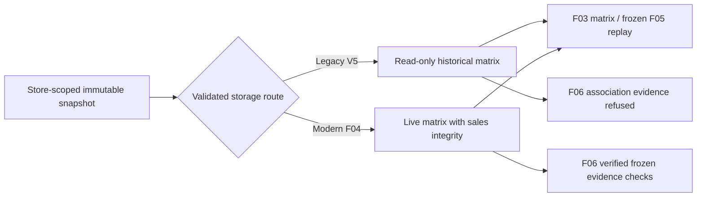

# Historical Utility Matrix compatibility and recovery operations

Date: 2026-10-22, Asia/Ho_Chi_Minh. Implementation verification is recorded in the linked recovery test report; this document is not deployment authorization.

## Identity and storage

V5 transaction IDs identify prepared-source transactions within an immutable snapshot. The same number may appear in multiple Stores or snapshots. They are not automatically `sales_transaction.transaction_id` values. The canonical legacy reference is `(snapshot_id, transaction_id)`, with Store resolved through the snapshot. Original matrix item IDs, Product IDs, quantities, scores, utility values, dates, hashes and snapshot JSON are retained.

The original physical `utility_matrix_item` table is atomically renamed to `utility_matrix_item_legacy_v5`; there is no historical row deletion or synthetic sales backfill. An empty replacement retains the canonical name and receives the original V7 sales FK and V8 optional evidence column. V11 creates compatible archive/routing structures for fresh and already-upgraded installations. Archive fields retain the V5 types and semantics; the archive does not acquire an invented sales FK.

`utility_snapshot_storage` records snapshot/Store/storage route and source namespace. Namespaces from frozen metadata retain the `V5:` prefix; missing source is explicitly `UNVERIFIED:SNAPSHOT:<id>`. Even known `DEV_FIXTURE` provenance is not authenticated retail transaction evidence. Registry metadata is additive; it does not overwrite frozen configuration JSON.



## Registered pre-V7 transition

Spring Boot discovers `LegacyRecoveryConfiguration` and registers `LegacyRecoveryCallback` with its Flyway instance. The callback is scoped to `beforeEachMigrate` for V7. A V11-only fix cannot solve a failure inside V7. Do not assume an external Flyway CLI discovers a Spring bean: use the application migration process or explicitly register the callback in supported programmatic migration code.

For a populated target, set the following external properties through the deployment's secret/configuration mechanism:

| Property | Purpose |
|---|---|
| `paspm.legacy-recovery.enabled` | Explicitly enable the approved transition |
| `paspm.legacy-recovery.manifest` | Owner-only verified manifest path |
| `paspm.legacy-recovery.restore-url` | Separate verification database restored by the verifier |
| `paspm.legacy-recovery.restore-user` | Identity restricted to verification schema; callback opens a read-only connection |
| `paspm.legacy-recovery.restore-password` | Private credential, never committed |

The default does not authorize a populated transition. Keep original V1–V10 bytes/checksums unchanged, Flyway validation enabled and out-of-order migration disabled. Quiesce all writers during backup validation, migration and reader cutover; Flyway's schema-history lock is not a lock on all application writes. Identify the target positively; this task never authorizes writes to the original configured V5 database.

## Verified backup preparation

Use an approved full backup and prepare a different **new empty** verification schema with a credential restricted to that exact schema. `LegacyBackupVerifier` itself restores the exact supplied artifact, checks process completion, compares canonical original matrix/header datasets, binds the manifest to target/restored server UUID and schema, and records the backup file SHA-256 plus owner approval reference. It refuses a preexisting populated verification schema, including an otherwise matching copy, because that would not prove the file was restored. Retain the backup and resulting restored database throughout migration/restarts. Migration re-reads the restored dataset and backup hash; a hand-written boolean is insufficient.

Command shape (all credentials supplied privately, no example passwords):

```sh
java -cp "target/classes:$MAVEN_RUNTIME_CLASSPATH" \
  vn.edu.fpt.paspm.deployment.legacy.LegacyBackupVerifier \
  "$VERIFIED_BACKUP_FILE" "$PRIVATE_MANIFEST_FILE" "$OWNER_APPROVAL_REFERENCE"
```

Its environment uses `PASPM_RECOVERY_TARGET_URL`, `PASPM_RECOVERY_USER`, `PASPM_RECOVERY_PASSWORD`, `PASPM_RECOVERY_RESTORE_URL`, `PASPM_RECOVERY_RESTORE_USER` and `PASPM_RECOVERY_RESTORE_PASSWORD`. The target and restored connections must identify different databases. Manifest permissions are owner-only; exclude backup, manifests, secrets and raw logs from Git.

The supplied verifier proves matrix/header logical equivalence and backup-file identity. A full operational restore rehearsal must also validate every business table, grants, application version, capacity and cutover/PITR needs. The current isolated fixtures are simulated; no authentic historical transaction mapping is claimed.

## MySQL checkpoints and recovery

MySQL DDL has implicit commit boundaries. Recovery therefore uses `utility_legacy_recovery_journal`, canonical fingerprints and explicit durable phases rather than assuming transaction rollback undoes DDL:

1. Verify clean history, original dataset, backup binding and absence of partial F04 objects.
2. Record `PREPARED`; create and validate an empty stage, its keys/constraints and identity range.
3. Record `STAGED`; atomically rename original to archive and stage to live.
4. Validate unchanged archive, complete immutable guards/routing and record completion.
5. Continue original V7–V10 and additive V11; validate historical and modern reads before reopening traffic.

Known callback checkpoints are resumable only when schema, journal, manifest and data agree. Unknown stage/archive objects, tampered fingerprints, mixed storage or incomplete V7 SQL refuse. A normal retry must not invoke repair or discard objects.

If V7 SQL has already failed, preserve the failed database and history for investigation. Restore an approved clean backup into a separate target, compare it, regenerate the target-bound verification manifest, then rehearse recovery there. Do not clean/reset the original or blindly repair Flyway history. After new traffic, a reverse table rename or old application binary is unsafe; reconcile post-backup writes and use a separately reviewed forward-repair/cutover plan.

## Privileges and immutability

Archive DML, historical header/routing mutation and Store transfers of archived Products are guarded by the database. Frozen creator identity is retained; later creator Store membership changes are not interpreted as historical ownership. New modern rows must maintain Store ownership across snapshot, Product and actual sales records. Ordinary application paths do not write the archive.

Use a separate migration identity and least-privilege runtime grants. MySQL binary logging may require DBA authority to install triggers; do not solve that by granting SUPER to the application or globally weakening binary-log trust. Privileged `DROP`/`TRUNCATE` and administrative trigger removal are outside DML-trigger protection; deny those privileges to the runtime identity and restrict backup/manifest/journal access.

## F03–F06 compatibility boundary

A missing route for an unverified EMPTY snapshot permits read-only count/page only after proving both matrix tables empty and frozen total zero. It creates no F04 provenance and cannot authorize writes/F06. Unknown populated sources still refuse.

Historical F03 matrix/detail and F05 mining consume original frozen rows and grouping, with legacy optional expiry evidence projected as NULL. No recalculation against current inventory, date or utility configuration is permitted. Existing frozen mining requests and stored pattern evidence remain unchanged.

F06 must not derive supportCount/confidence or retail association evidence from legacy Weighted Utility alone. Unverified historical sources require an explicit conflict response instead of invented transaction membership. Authentic mapping/backfill is a separate future approval and is not implemented by this recovery.

See [recovery design](V5_V7_HISTORICAL_MATRIX_RECOVERY_DESIGN.md) and [test plan/results](../testing/V5_V10_POPULATED_MATRIX_RECOVERY_TEST_PLAN.md) for actual implementation status, acceptance evidence and remaining risks.

Final isolated verification on2026-10-23:254 feature tests and299 detached Product compatibility tests passed without skips; both Maven verify processes exited0. See the test inventory for service/HTTP/mock and crash-simulation limits.
