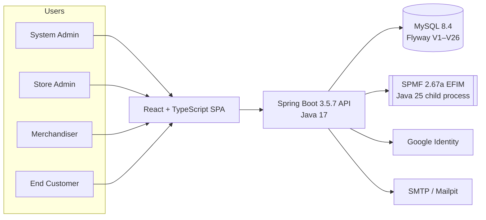
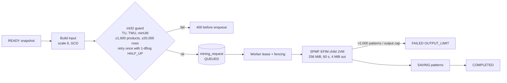

# PASPM — Architecture & Software Design (agent edition)

| Field | Value |
|---|---|
| Project | PASPM (FA26SE048) |
| Version / date | 0.4 — 2026-11-20 (synced with `dev` @ `636952b`) |
| Baseline | Backend `dev` @ `530651b` (repo `PhanHoangDuy61/CP_FA26_PASPM_BE`); frontend `ThaiTuKien1012/FE-FA26` `dev` @ `86d677d` |
| Audited against code | `530651bad5b02d90bcb48ecffaf7fa5a0f6b0b7e`, see (audit report kept outside the repo, 2026-11-19) |
| Synced with | `dev` @ `636952b` (2026-11-20): F02 update `d22f735`; PR #20 (decisions); PR #21 (F04 Excel); PR #22 (zone caps, top-K baseline, equal-size simulation, DEC-20261119-06); PR #23 (SPMF whole-đồng fallback, DEC-20261119-05); PR #25 (agent kit). Checked for these changes only, not a full re-audit |
| Based on | Report 4 (SDD, 04 Nov 2026) updated with code through V26 |
| Companion files | [BRD_VISION.md](BRD_VISION.md) · [SRS.md](SRS.md) · [GLOSSARY.md](GLOSSARY.md) |

> Counts in this file come from a static reading of the repository: tables from the `CREATE TABLE` statements in the migrations and in `deployment/legacy/LegacyRecoverySchema.java` (called by V11), operations from `docs/api/openapi.json`. They have not been re-verified against a live database. Planned modules are labelled **PLANNED**.

---

## 1. System context



PASPM is **one web application**: a React single-page app and a single Spring Boot backend organised by business domain, sharing one MySQL database. Background work runs inside the backend process: the async import worker, the mining worker and the schedule dispatcher. Each of them polls database tables and holds leases. Mining is delegated to SPMF, which runs in an isolated Java 25 child process because the backend runs on Java 17.

## 2. Components

| # | Component | Responsibility | Status |
|---|---|---|---|
| 1 | React + TypeScript SPA | Role-guarded routes and API clients. Sends the Bearer token, and the CSRF header on refresh | DONE for F01–F06 (API clients on FE `dev` @ `86d677d`); F07/F08 in progress (mock screens only, on the local branch `feature/f07-f11-mock`) |
| 2 | REST controllers | HTTP endpoints for each domain. Swagger at `/swagger` | DONE (123 operations at `222e54f`) |
| 3 | Spring Security | JWT resource server, role checks, Store scope from the token, rate limits, refresh/CSRF session service | DONE |
| 4 | Application services | Validation, Store scoping, transaction boundaries, optimistic versions | DONE |
| 5 | Weight v2 calculator | `ExpiryRiskCalculator` (FEFO by push day), `WeightV2Calculator` (sales rate v, seasons M), `UtilityMath` (W, rounding) | DONE |
| 6 | Utility freezer / snapshot | Builds the matrix, freezes the configuration, seasons and warnings, and writes hashes | DONE |
| 7 | Transaction source | Supplies eligible transactions of a Store for a date range | DONE |
| 8 | Async import worker | Claims queued CSV batches and processes staging rows with progress | DONE (V22) |
| 8a | Excel import | Synchronous XLS/XLSX parsing (Apache POI 6.0.0) into the same F04 order pipeline | DONE (PR #21, 2026-11-19) |
| 9 | Mining input builder | Snapshot → SPMF input: scale-6 / GCD conversion, EFIM-aware int32 guard, int64 totals | DONE |
| 10 | Mining worker | Claims requests with a lease and fencing token, writes progress stages, runs SPMF, parses and persists patterns | DONE |
| 11 | Schedule dispatcher | Turns due occurrences into a snapshot plus a request (SYSTEM_SCHEDULER principal). Enable returns **503** | PARTIAL |
| 12 | SPMF child process | Runs EFIM with heap, time, output and log limits. Output limit is enforced by the kernel on Linux and macOS, by polling on Windows | DONE |
| 13 | Recommendation rules | BUNDLE / CROSS_SELL / FBT / BANNER from frozen evidence, live eligibility and fingerprint | DONE |
| 14 | Layout & campaign | Baseline A, layout B revisions, zone policy, utility score, campaign lifecycle, offline replay simulation, active-layout projection | DONE (API); frozen priority coverage merged in PR #32 (`516183d`) |
| 15 | Persistence | Hybrid: JPA for products and categories, JDBC (`JdbcTemplate`) for everything else | DONE |
| 16 | Deployment / legacy recovery | Flyway callback and recovery of legacy utility-matrix data | DONE |
| 17 | Storefront public API | Anonymous read by `storeSlug` (= `store.slug`), ACTIVE Stores only, non-deleted ACTIVE products | DONE (API, MVP; DEC-20261125-04) |
| 18 | Cart service plus `storefront_event` | Customer cart, component-level bundle add, event log | **PLANNED** (F10) |
| 19 | Dashboard | Aggregates for F11: snapshot weighted utility, `comparison_report` results, `storefront_event` bundle counts | **PLANNED**, MVP scope decided 2026-11-19 |

## 3. Module (package) map

Root package: `vn.edu.fpt.paspm`. Java migrations live in `db.migration`.

| Package | Domain | Java files | Contents |
|---|---|---|---|
| `auth` | Identity | 9 | Login, Google, OTP, refresh/CSRF sessions |
| `user` | Identity | 8 | Accounts, roles, Store assignment, avatar |
| `catalog` | F02 | 21 | Categories (JPA), products (JPA), inventory batches and push day (JDBC). `catalog.store` (F01, DEC-20261123-01): Store administration, own Store profile, icon/banner and public image controllers (JDBC) |
| `transaction` | F04 | 13 | CSV parsing, validation, sync and async import, queries, eligible source |
| `utility` | F03 | 31 | Configuration, λ policy, seasons, Weight v2, matrix, snapshots, versioned JSON readers |
| `mining` | F05 | 28 | Configuration, requests and runs, worker, progress, scheduler, SPMF runtime |
| `recommendation` | F06 | 14 | Rules, evidence reader, eligibility, review, policy |
| `layout` | F07/F08 | 7 | `LayoutCampaignController`, `LayoutCampaignService`, `LayoutCampaignRepository`, `LayoutRules`, `OfflineLayoutSimulation`, `LayoutPolicyProperties`, `LayoutContracts` |
| `security` | Shared | 5 | JWT, RBAC, rate limits, the central Store status guard (`StoreStatusGuard`) |
| `common` | Shared | 7 | Errors, shared contracts, transaction manager. `common.media`: `MediaStorage` / `LocalMediaStorage` (Store images, avatars) |
| `deployment` | Ops | 5 | Flyway callback, legacy recovery |
| `storefront` | F09 | `StorefrontController`, `StorefrontService`, `StorefrontRepository` | DONE (MVP). Separate public controller; reads the active selected layout and rechecks recommendation blocks |
| *(planned)* `cart`, `dashboard` | F10–F11 | — | **PLANNED** |

Dependency rules:
- Downstream modules read upstream data through **frozen artifacts**: F05 reads the snapshot, F06 reads the run and its patterns, F07/F08 read the recommendations and snapshot. They never read live mutable data for historical results.
- Live data is used only for current eligibility and stock.
- Report 4 notes two mutual package dependencies: Identity & Access ↔ Shared Kernel, and Catalog & Inventory ↔ Mining. Do not add new cycles.

## 4. End-to-end workflow

```mermaid
sequenceDiagram
  actor SA as Store Admin
  actor ME as Merchandiser
  actor EC as End Customer
  participant API
  participant W as Workers
  participant DB as MySQL
  SA->>API: products, batches (+push day)
  SA->>API: POST CSV import (async)
  W->>DB: staging → transactions (progress)
  ME->>API: λ, α, β, N; seasons; preview
  ME->>API: create snapshot (immutable)
  ME->>API: POST mining request {requestKey, snapshotId}
  W->>W: build input, int32 guard, run EFIM (child JVM)
  W->>DB: run + patterns, stages QUEUED→RUNNING→SAVING→COMPLETED
  ME->>API: generate recommendations (runId, types)
  ME->>API: approve/reject (expectedVersion, reason)
  ME->>API: create campaign (A baseline + B), edit B, ready
  ME->>API: simulate (offline replay) → report
  ME->>API: decide + publish
  SA->>API: activate campaign (one active per Store)
  EC->>API: storefront / bundle cart (PLANNED F09–F10)
```

## 5. Data design

### 5.1 Migrations

Never edit V1–V26. New schema always goes in V27 or later (V27 is taken by Store management, V28 by product soft delete, V29 by the old F09 merge on `dev`, V30 by the F09 cleanup, V31 reserved for F10; use V32+ next).

| Version | Purpose |
|---|---|
| V1–V2 | Store, roles, users, OTP (F01) |
| V3 | Catalogue and inventory batches (F02) |
| V4–V5 | F03 configuration, scores, immutable snapshots |
| V6 | Profile avatar |
| V7 | F04 import pipeline |
| V8 | Product binary expiry priority (legacy) |
| V9 | F05 mining engine |
| V10 | F06 recommendations |
| V11 *(Java)* | Historical utility-matrix storage and legacy archive |
| V12 | F04 large raw import rows |
| V13 | Mining administration configuration |
| V14–V19 | Scheduler, frozen occurrence context, leases, recovery, SKIPPED status, scheduler principal |
| V20–V21 | Refresh sessions and CSRF binding |
| V22 | Async imports |
| V23 | F07/F08 layout and campaign (8 tables) |
| V24 | Mining progress |
| V25 *(Java)* | Weight v2: `season`, `product_season`, `utility_snapshot_season`, `utility_weight_v2_conversion`, batch `push_day`, configuration conversion |
| V26 *(Java)* | Drops `product.expiry_push_days`, `stock_priority_score`, `seasonal_priority_score` |
| V27 *(Java)* | `store`: `slug` (backfilled `slugify(name)-{id}`, then NOT NULL + UNIQUE, random-UUID default for raw inserts), `status`, `address`, `phone`, `icon_key`, `banner_key`, `version`, `created_at`, `updated_at`, `deactivated_at`, `deactivated_by` (FK `app_user`) — DEC-20261123-01 |
| V28 | `product`: `deleted_at TIMESTAMP NULL`, `deleted_by INT NULL` (FK `app_user`), CHECK both-or-neither, index `(store_id, deleted_at)`. Nothing is backfilled — DEC-20261124-03 |
| V29 *(Java)* | Old F09 merge on `dev` (`68d6f0b`), kept unchanged: `store.store_slug` (backfilled, unique `uq_store_store_slug`), `store.storefront_enabled BOOLEAN NOT NULL DEFAULT FALSE`, `product.image_url VARCHAR(2048) NULL`, `product.description TEXT NULL` |
| V30 | Drops `uq_store_store_slug`, `store.store_slug` and `store.storefront_enabled`. F09 uses `store.slug` and `store.status`; `product.image_url`/`description` stay — DEC-20261125-04 (addendum "Migrations") |

### 5.2 Tables

There are **45 tables**: 31 from V1–V19, plus 2 (V20), 8 (V23) and 4 (V25), with 100 foreign keys. The 31 are 29 from the SQL migrations plus `utility_matrix_item_legacy_v5` and `utility_snapshot_storage`, which `LegacyRecoverySchema` creates when V11 runs. The recovery-only tables `utility_legacy_recovery_journal` and `utility_matrix_item_f04_stage` exist only on the legacy recovery path and are not counted.

| Area | Tables |
|---|---|
| Identity & access | `store`, `role`, `app_user`, `verification_challenge`, `external_identity`, `auth_refresh_session`, `auth_refresh_token` |
| Catalogue & inventory | `category`, `product`, `inventory_batch` (+`push_day`) |
| Transaction import | `api_connection` (unused), `import_batch`, `import_staging_row`, `sales_transaction`, `transaction_item` |
| Utility & snapshot | `system_configuration` (λ policy), `utility_snapshot`, `utility_matrix_item`, `utility_matrix_item_legacy_v5`, `utility_snapshot_storage`, `season`, `product_season`, `utility_snapshot_season`, `utility_weight_v2_conversion` |
| Mining | `mining_config_head`, `mining_config_version`, `mining_request`, `mining_run`, `high_utility_pattern`, `pattern_item`, `mining_schedule`, `mining_schedule_occurrence` |
| Recommendation | `recommendation_rule_config`, `recommendation`, `recommendation_item`, `recommendation_source`, `recommendation_review_history` |
| Layout & campaign | `campaign`, `campaign_history`, `storefront_layout`, `storefront_layout_revision`, `layout_placement`, `comparison_report`, `comparison_report_layout`, `comparison_report_transaction` |
| *(PLANNED F10)* | Cart tables, `storefront_event`. Names are not final |

### 5.3 Data invariants

- **Store isolation in the schema.** Store-scoped tables carry `store_id`. Child records use composite foreign keys `(store_id, id)`, so they can only reference rows in the same Store.
- **Immutability.** Snapshots, matrix rows, mining runs and patterns, review history, layout revisions and simulation reports are append-only.
- **Versioned JSON.** Frozen JSON columns carry `scoringVersion` and are never rewritten. Readers keep the legacy record types.
- **Optimistic concurrency.** Versioned rows (configurations, seasons, recommendations, layouts, campaigns, schedules) use `version` / `expectedVersion`, and a stale version returns 409.
- **Idempotency.** Mining requests use `(store_id, request_key)` and imports use an idempotency key. Recommendation identity is `(store_id, identity_hash)`.

### 5.4 State machines

| Entity | States |
|---|---|
| Import batch | Sync: `PROCESSING → COMPLETED / COMPLETED_WITH_ERRORS / FAILED`. Async: status `RECEIVING → QUEUED → PROCESSING → terminal`, with stage `RECEIVING → QUEUED → IMPORTING → terminal` (`LEGACY` stage for old rows) |
| Utility snapshot | `READY`. `FAILED` is allowed by the schema but never written |
| Mining request | `PENDING → RUNNING → COMPLETED / FAILED`, with stage `QUEUED → RUNNING → SAVING → COMPLETED / FAILED` (`LEGACY` for rows older than V24; `COMPARING` only for legacy two-run requests) |
| Schedule occurrence | Statuses `PENDING` (reserved), `PROCESSING`, `DISPATCHED`, `COMPLETED`, `FAILED`, `SKIPPED`. Older missed fire times are `SKIPPED`. `FAILED` with `RETRY_EXHAUSTED` after at most 3 preparation attempts |
| Recommendation | `PENDING_REVIEW → APPROVED / REJECTED`. Ready is derived at read time |
| Store | `ACTIVE ⇄ INACTIVE` (System Admin, `expectedVersion`); no final state (never deleted) — DEC-20261123-01 |
| Layout B | Draft revision → `READY`. Any edit makes a new revision and clears the decision. `ARCHIVED` is allowed by the schema but never written |
| Campaign | `DRAFT → PUBLISHED → ACTIVE → ENDED`, plus withdraw (PUBLISHED → DRAFT) and rollback (the ACTIVE campaign → ENDED, and the previously active campaign ENDED → ACTIVE, or the default layout if there is none) |

## 6. Key designs

### 6.1 Weight v2 (F03)

1. Read the analysis date, the configuration (λ, α, β, N) and λmax.
2. For each product:
   - compute **v** = units in COMPLETED, eligible transactions over the last N days ÷ N;
   - sort the eligible batches FEFO by push day, then by id;
   - each batch sells at most `v × days_to_push − units already absorbed by earlier batches`, and whatever is left counts as Q_risk;
   - U_expiry = Q_risk / Q_eligible.
3. M = the highest weight among the product's active seasons.
4. W = round₂(1 + λ(αU + βM)).
5. Weighted utility = Base × W at scale 6. Freeze everything, including the warnings `MISSING_PUSH_DAY` and `SLOW_MOVING`.

### 6.2 Mining pipeline (F05)



- The percentage threshold is converted once, using the int64 total.
- Every stage write is fenced, so a stale worker cannot overwrite the state.
- The child process is killed if the parent dies (`PR_SET_PDEATHSIG` on Linux).

### 6.3 Recommendation and eligibility (F06)

- Candidates come from the frozen run evidence: support, confidence and anchor.
- Eligibility is evaluated live on every read. It checks product status, active batches with remaining > 0, and an expiry date on or after today for any batch that has one (a batch is expired only when today is after its expiry date; changed 2026-11-24, DEC-20261124-01). A batch of a product that requires expiry but has no expiry date gives `NEEDS_RECHECK`.
- A fingerprint detects inventory or metadata changes.
- Known issue: 3 queries per product (product, batches, units sold — N+1), not yet measured.

### 6.4 Layout and campaign (F07/F08)

- **Baseline A** is the top-K snapshot products by transaction frequency (`F07_BASELINE_V2`, K = BASELINE capacity 35; older V1 layouts hold every product).
- **Layout B** is built per product with optional F06 provenance, within the configured zone capacities. One source recommendation may be split across placements, and manual placement source is null. F06 evidence and Layout A are immutable.
- **Zones** are `BASELINE`, `BUNDLE`, `CROSS_SELL`, `FBT` and `BANNER`. Capacities are configured in `application.yml` since PR #22, and environment-overridable: BANNER 3 blocks / 3 products, BUNDLE 4 / 16, CROSS_SELL 2 / 8, FBT 2 / 8, BASELINE 35 / 35.
- **Score** = Σ weighted utility of the distinct products shown.
- **Simulation** runs only on a DRAFT campaign. It replays later eligible transactions that are not in the snapshot, and stores the dataset hash, the transaction ids and the assumptions. Since PR #22 (`OFFLINE_REPLAY_V2`), B is compared with the top-N prefix of A, where N = products in B.
- **Activation** locks the Store row, rechecks validity, ends the previously active campaign and records history.
- **Priority coverage (OFFLINE_REPLAY_V4):** distinct displayed products with W > 1 divided by the distinct products displayed. The service reads W from the frozen campaign snapshot and saves the rate and denominator in `comparison_report_layout`. Layout views use their complete placement list, and reports use the actual A prefix and full B. Historical reports are read as stored.

### 6.5 Storefront (F09 — DONE, MVP) and cart (F10 — PLANNED)

- `StorefrontController` (anonymous GETs, permitted in `SecurityConfig`) resolves `storeSlug` = `store.slug` of an ACTIVE Store to the active campaign's selected READY layout. With no ACTIVE campaign it returns `DEFAULT_CATALOG` (ACTIVE, non-deleted products by category), not baseline A.
- Public DTOs carry no cost or batch data. `availability` is computed with aggregate queries.
- The cart is per customer and per Store. Every mutation checks the optimistic version from If-Match.
- Whole-bundle add resolves the F09 key against active Layout B, checks each component, merges eligible Product lines, advances cart version and records one successful event in a transaction. An all-skipped request records rejection without a cart change.
- Planned V31 creates `shopping_cart`, `shopping_cart_item` and `storefront_event`. F11 reads snapshot, comparison report and bundle event aggregates without a separate schema. Migrations after V31 start at V32. See [DEC-20261125-06](../decisions/2026-11-25/DEC-20261125-06-f10-f11-mvp-contract.md).

## 7. Cross-cutting concerns

| Concern | Design |
|---|---|
| Authentication | Access JWT (Bearer). Refresh token in an HttpOnly cookie, rotated on use, bound to CSRF. The cookies are `__Host-PASPM-REFRESH` / `__Host-PASPM-CSRF` when `paspm.refresh-cookie-secure=true` (the default). With `false`, they are the unprefixed `PASPM-REFRESH` / `PASPM-CSRF`, allowed only on localhost. `token_version` revokes sessions |
| Authorization | Role check on each operation. Store scope comes from the token: another Store's resource returns 404, a role violation 403 |
| Errors | `{"error":"…"}` with the HTTP status code (`UNSUPPORTED_SCORING_VERSION` and `STORE_INACTIVE` also add `"code"`). Unknown JSON fields return 400 `Invalid request fields` |
| Store status | One central guard in the JWT converter and at token issuance/refresh: users of an INACTIVE Store get 403 `STORE_INACTIVE`. System Admin new work and user assignment for an INACTIVE Store: 409. Scheduler: SKIPPED `STORE_INACTIVE` |
| Media | `MediaStorage` (local filesystem under `PASPM_MEDIA_ROOT`, Docker volume `paspm_media`). Keys are relative; files get UUID names; old files are deleted after commit, new files on rollback. Public GET only for current images of ACTIVE Stores |
| Time | Instants are stored in UTC (`connectionTimeZone=UTC`). Store-local dates use `Asia/Ho_Chi_Minh` (`paspm.store-time-zone`) |
| Numbers | Money: 2 decimals. Utility: 6 decimals HALF_UP. W: 2 decimals HALF_UP. Scaled totals are int64 |
| Async work | Database-backed queues, leases, fencing, polled progress. No message broker |
| Auditing | Review history, campaign history, the System Admin request-policy audit log |
| Secrets | Environment variables only (`JWT_SECRET`, `OTP_SECRET`, `DB_PASSWORD`, …). The committed `application.yml` holds `${…}` placeholders with no secret defaults. Rotate any secret that has been exposed |

## 8. Technology and environments

| Item | Declaration |
|---|---|
| Backend | Java 17 (Temurin), Spring Boot 3.5.7 (Web, Security, OAuth2 Resource Server, JDBC, Data JPA, Mail, Validation), Flyway, springdoc-openapi 2.8.14, Commons CSV 1.14.1 |
| Mining | SPMF 2.67a (GPL v3), archive SHA-256 `4aa46838…dfe6a`, run on a Java 25 runtime as a **separate process** only; redistributed through the GitHub Release `spmf-2.67a` with its license and source; the Docker image (linux/amd64) carries them in `/opt/paspm/licenses/` (DEC-20261125-03, `THIRD_PARTY_NOTICES.md`) |
| Frontend | React 19, Vite 8, TypeScript 7, Tailwind CSS 4 (from `package.json` on FE `dev` @ `86d677d`). Branches: FE-FA26 `dev`; `feature/f07-f11-mock` exists only as a local branch (not on `origin`); `origin/feature/fe-v26-integration` (2026-11-19) removes part of the legacy API usage |
| Database | MySQL 8.4 (local install or Docker Compose). H2 is used in some tests (test scope in `pom.xml`) |
| CI | GitHub Actions workflow "Backend verification", with jobs "SPMF downloader security", "Java 17 Backend foundation", "MySQL 8.4 / Flyway V1-V11 / F04 transactions", "Full F01-F06 / Flyway / SPMF HUI-Miner-EFIM" (job names not yet updated for EFIM-only) and "Required Backend verification". The `integration` job reads the repository **variable** (not a secret) `PASPM_CI_SPMF_ARTIFACT_URL`. It was recorded as **missing** on 2026-11-16 (ROC-20261116-012); its current value is UNVERIFIED |
| Branching | `<member>/<type>/<topic>` branches merge into `dev` **only through a PR with green CI** (binding rule since 2026-11-19; earlier merges were pushed directly) |
| Environments | Dev on Windows and macOS. Staging on Linux Docker Compose is **planned**. Production is out of scope |
| AI tools | Claude Code, OpenAI Codex, Claude chat |

## 9. Diagrams: inventory as of 2026-11-04 and the changes they need

Two Draw.io files make up the baseline (DEC-20261126-01):

- **`PASPM_Unified_UML2_Editable.drawio`**: the **36-page** pack committed at `docs/diagrams/` (27 core diagrams, R2-05 Package Diagram and 8 class diagrams R2-07.01–08). The old 27-page copy was replaced, and the file was renamed from `PASPM_Unified_27_Diagrams_UML2_Editable.drawio` on 2026-11-26. The Store management pages (AD09, R2-06.07, R2-08.09, R2-07.09) and the pages AD10 and AD11 extend it to 42 pages.
- **`PASPM_ERD_V1_V30.drawio`** (`docs/diagrams/`, named after its last Flyway version), with 9 pages: Logical ERD, Conceptual ERD and 7 area diagrams. It replaces the V1–V19 file, which was never committed.

The tables below were written against the V1–V19 state and `dev` @ `530651b`; the diagram records of 2026-11-26 list which rows each phase closed.

**Rule:** keep the diagram IDs, layout and UML 2 notation, and edit only what changed. Pages describing features that are still planned stay labelled *planned*.

### 9.1 UML pack

| Page | Status | Changes needed |
|---|---|---|
| FR | Outdated | FR05 "Mining Configuration & Benchmark Hub": remove FR05.02 (select HUI-Miner/EFIM) and FR05.06 (benchmark); FR05.01 becomes minUtil only. FR03.01/03.02: Weight v2 (λ/α/β/N, seasons, batch push day). FR08.04: replace CTR/conversion with hit rate, bundle conversion, captured utility and priority coverage. FR11.04: remove benchmark charts. FR04: async import |
| Context | Minor | A3 OUT: remove "benchmarks" |
| Use Case | Outdated | UC04 drops "Select Algorithms". UC05 becomes "Submit Async EFIM Mining" with the Merchandiser added as an actor. **Remove UC08.** UC09: Weight v2 and seasons. UC32: λmax only. UC16: new metric list |
| AD01 Overall Workflow | Minor | "HUI-Miner / EFIM" becomes EFIM. Add Merchandiser mining submission |
| AD02 Transaction Processing | Update | Async import: QUEUED → IMPORTING, progress polling, idempotency key |
| AD03 Mining Execution | Update | No algorithm in policy. Remove the MATCH/FAILED/BLOCKED comparison. Add the int32 guard and the 400 branch, progress stages and OUTPUT_LIMIT |
| **AD04 Algorithm Benchmarking** | **Remove** | Benchmark removed 2026-11-16. Retire the page, or mark it historical |
| AD05 Recommendation | Minor | Add the `seasonEnded` / expiry-alert warnings from push day |
| AD06 Layout & Campaign | Update | Match the implemented flow: A generated read-only; B from whole blocks; READY; decide; publish / withdraw; activate / end / rollback |
| AD07 A/B Testing | Rewrite | Offline replay of later transactions, not synthetic CTR/conversion. Metrics: hitRate, bundleConversion, capturedUtility, priorityCoverage |
| AD08 Customer Shopping | Keep (planned) | Align with the F09/F10 MVP decisions: anonymous browse, END_CUSTOMER cart, component-level bundle add, no reservation |
| R2-03 Screen Flow | Update | Remove S06 Benchmark, Expiry Window and Product Scores. Add Seasons, push day, mining progress, λmax policy, F07/F08 screens |
| R2-04 System Architecture | Update | Utility box: "S/M priorities, E from batch expiry" becomes "U_expiry from batch push days + season M". SPMF box becomes EFIM. Add async import worker and Layout & Campaign. Frontend box: "Bearer token in local storage" becomes access token plus refresh cookie / CSRF. Rename "storefront checkout" (checkout is out of scope) |
| R2-05 Package Diagram | Update | Mining: remove "result comparison", add "progress". Layout and Campaign & A/B Testing are now implemented in the single `layout` Java package. Storefront, Cart and Dashboard stay planned |
| R2-06.01 Import Batch State | Update | Add async states and the `LEGACY` stage |
| R2-06.02 Utility Snapshot State | Keep | — |
| R2-06.03 Mining Request State | Update | Remove the comparison guards ("comparison is not FAILED"). Add stages QUEUED → RUNNING → SAVING → COMPLETED/FAILED |
| R2-06.04 Mining Run State | Minor | Add the OUTPUT_LIMIT failure |
| R2-06.05 Recommendation Review State | Keep | — |
| R2-06.06 Staging Row State | Minor | Add async `result_kind` / `result_group` if they are shown |
| R2-08.01 / R2-07.01 Seq & Class AD01 | Update | `submitMiningRequest(…, compareAlgorithms)` and `createAdministrative(…, compare)` drop the compare parameter. Remove `ComparisonReport` from the mining step |
| R2-08.02 / R2-07.02 Seq & Class AD02 | Update | Async import endpoint and worker |
| R2-08.03 / R2-07.03 Seq & Class AD03 | Update | Remove `compareAlgorithms`, `ComparisonStatus` and `RequestView.algorithms`. Add the int32 guard, `ProgressView` and the Merchandiser submit path |
| **R2-08.04 / R2-07.04 Seq & Class AD04** | **Remove** | `BenchmarkScreen` and `BenchmarkView`, with the benchmark route deleted |
| R2-08.05 / R2-07.05 Seq & Class AD05 | Minor | `ProductEligibilityService` now uses EligibilityV2 (push day, no `expiryPushDays`) |
| R2-08.06 / R2-07.06 Seq & Class AD06 | Rewrite | The designed `SimulationService` / `ComparisonReport(baselineLayoutId, candidateLayoutId, decision)` becomes the real `LayoutCampaignController` / `LayoutCampaignService` / `LayoutCampaignRepository` / `LayoutRules` and the campaign lifecycle |
| R2-08.07 / R2-07.07 Seq & Class AD07 | Rewrite | `MetricType {UTILITY, CTR, CONVERSION, ESTIMATED_REVENUE}` becomes `OfflineLayoutSimulation` with hitRate, bundleConversion, capturedUtility and priorityCoverage. Report tables: `comparison_report`, `_layout`, `_transaction` |
| R2-08.08 / R2-07.08 Seq & Class AD08 | Keep (planned) | Align `CartService.addBundle` with the F10 plan (If-Match, partial adds, `storefront_event`) |

### 9.2 ERD (V1–V19 → V26) — done 2026-11-19; committed 2026-11-26 as `PASPM_ERD_V1_V26.drawio` and extended to V30 in `PASPM_ERD_V1_V30.drawio` (DEC-20261126-01)

The file in `outputs/diagrams/` has 9 pages (the 8 listed plus the new Layout & Campaign page). Its Logical ERD draws 45 tables and 100 relationship edges, matching §5.2 and §10.

| Page | Changes needed |
|---|---|
| Logical ERD | Add 14 tables: `auth_refresh_session`, `auth_refresh_token` (V20, plus `csrf_hash` in V21); `campaign`, `campaign_history`, `storefront_layout`, `storefront_layout_revision`, `layout_placement`, `comparison_report`, `comparison_report_layout`, `comparison_report_transaction` (V23); `season`, `product_season`, `utility_snapshot_season`, `utility_weight_v2_conversion` (V25). Apply the column changes listed below. Change the title from V1–V19 to V1–V26. Recount the foreign keys |
| Conceptual ERD | Replace the planned `ComparisonReport` with the real Campaign / Layout / Revision / Placement / Report entities. Add Season and its assignments, and RefreshSession |
| Identity & Access | Add `auth_refresh_session` and `auth_refresh_token` |
| Catalog & Inventory | `product`: **add** `deleted_at TIMESTAMP NULL`, `deleted_by INT NULL` (FK `app_user`, CHECK both-or-neither) and index `(store_id, deleted_at)` (V28, DEC-20261124-03); **drop** `stock_priority_score`, `seasonal_priority_score`, `expiry_push_days` (V26). `inventory_batch`: **add** `push_day DATE NULL` with CHECK `push_day ≤ expiry_date` (V25) |
| Transaction Import | `import_batch` gains `idempotency_key`, `content_sha256`, `created_at`, `updated_at`, `processing_started_at`, `input_total_count`, `stage`, `lease_owner`, `lease_fence`, `lease_until`, and UNIQUE (`store_id`, `idempotency_key`). `import_staging_row` gains `result_group`, `result_kind` (V22) |
| Utility & Snapshot | `utility_matrix_item` gains `expiry_risk`, `season_weight`, `season_id` and an FK (`snapshot_id`, `season_id`) → `utility_snapshot_season`. The old `stock_score`, `expiry_score` and `seasonal_score` stay for legacy rows (V25). Add the 4 V25 tables |
| Mining & Scheduling | `mining_request` gains `stage`, `stage_started_at`, `current_run_id` with an FK to `mining_run` (V24). Mark `compare_algorithms`, `algorithms` and `comparison_status` as legacy: EFIM-only, no schema change |
| Recommendation | V23 adds a unique key on `recommendation` (store, snapshot, id), used by `layout_placement` |
| *(new page)* Layout & Campaign | The 8 V23 tables with their composite foreign keys (`store_id`, `campaign_id`, `utility_snapshot_id`, …) |

## 10. Report 4 items superseded

The following Report 4 items are outdated:

- **Schema:** "Flyway V1–V19", "31 tables / 59 FKs" and the product columns.
- **Architecture:** "HUI-Miner or EFIM", "HUI-Miner/EFIM result comparison", the benchmark sections (§3.4) and the `mining_request` "algorithms, comparison status" fields for new requests.
- **Weights:** "stock and seasonal product priorities", the expiry score from `expiryPushDays` and the "32-bit integer check" on the global total.
- **Modules:** Layout, Campaign, Storefront, Cart and Dashboard are all described as "not yet in the code". Layout and Campaign are now implemented.

After V26 there are **100 foreign-key constraints** (59 in V1–V19, plus 2 in V20, 29 in V23, 1 in V24 and 9 in V25), counted from the migration DDL. The 59 are 54 in the SQL migrations plus 5 that `LegacyRecoverySchema` adds when V11 runs. The updated `PASPM_ERD_V1_V26.drawio` draws all of them.
