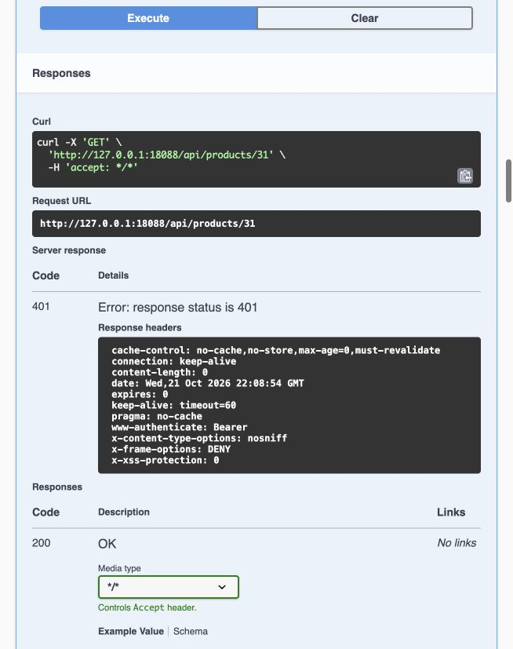

# JPA Pilot — Fresh Swagger UI Verification

Execution date: **2026-10-22, Asia/Ho_Chi_Minh**. Branch `Khoi/Fear/jpa-product-metadata-pilot`, implementation `48bc059`. Data: **SIMULATED_DATA_TESTED**. Browser: in-app browser controlled through CUA. Backend Java17 / Boot3.5.7 on isolated MySQL V10, loopback `http://127.0.0.1:18088/swagger-ui/index.html`.

## Method and status

**SWAGGER_UI_TESTED:18/18 PASS.** Actual UI interactions: Login endpoint → Try it out → Execute; token captured privately → Authorize; individual Product operations → Try it out → Execute. This is not curl/HTTP-client output relabelled as UI testing. Browser tokens/passwords never placed in reports; Authorize cleared after testing. Authentication performed for Store AdminA, Store AdminB and Merchandiser. LoginA is included as SW-00; supporting B/M logins also returned200 but are not counted again as separate Product scenarios.

Runtime OpenAPI is freshly fetched from the same running backend: **59 paths**, equal to the original JDBC baseline after excluding the runtime `servers` URL. Controller/DTO/schema not changed. Product table has no created_at/updated_at columns: timestamp assertions for Product are NOT APPLICABLE, no fields invented.

## Actual scenarios

Expected/Actual columns are HTTP codes from the **Server response** table, not the static response examples below it.

| ID | Method / endpoint | Role | Expected / Actual | Status | Request and expected behavior |
|---|---|---|---|---|---|
| SW-00 | POST `/api/auth/login` | STORE_ADMIN_A | 200 / 200 | PASS | Authenticate simulated Store Admin; credentials redacted |
| SW-01 | GET `/api/products` | STORE_ADMIN_A | 200 / 200 | PASS | categoryId=37,status=ACTIVE,pageSize=5; one owned milk product |
| SW-02 | GET `/api/products/{id}` | STORE_ADMIN_A | 200 / 200 | PASS | id31; existing SIMULATED milk, stock8 |
| SW-03 | POST `/api/products` | STORE_ADMIN_A | 201 / 201 | PASS | SIMULATED coffee; valid StoreA category, bag, prices90000/50000, ACTIVE |
| SW-04 | PUT `/api/products/{id}` | STORE_ADMIN_A | 200 / 200 | PASS | id31; name edited, price32000, original SKU/category; stock must stay8 |
| SW-05 | PATCH `/api/products/{id}/status` | STORE_ADMIN_A | 200 / 200 | PASS | id31,status=INACTIVE; stock8 |
| SW-06 | PATCH `/api/products/{id}/status` | STORE_ADMIN_A | 200 / 200 | PASS | id31,status=ACTIVE; stock8 |
| SW-07 | GET `/api/products/{id}` | STORE_ADMIN_A | 200 / 200 | PASS | id31; verify PUT/PATCH persisted |
| SW-08 | POST `/api/products` | STORE_ADMIN_A | 400 / 400 | PASS | synthetic SKU, sellingPrice=-1 |
| SW-09 | POST `/api/products` | STORE_ADMIN_A | 409 / 409 | PASS | repeat created coffee SKU in same Store |
| SW-10 | GET `/api/products/{id}` | UNAUTHENTICATED | 401 / 401 | PASS | id31,no token |
| SW-11 | GET `/api/products/{id}` | STORE_ADMIN_B | 404 / 404 | PASS | id31 owned by StoreA |
| SW-12 | PUT `/api/products/{id}` | STORE_ADMIN_B | 404 / 404 | PASS | valid StoreA metadata for id31; modification forbidden |
| SW-13 | GET `/api/products` | STORE_ADMIN_B | 200 / 200 | PASS | own StoreB list; expected totalElements0 |
| SW-14 | POST `/api/products` | MERCHANDISER | 403 / 403 | PASS | valid synthetic Product metadata; role cannot write |
| SW-15 | GET `/api/products/{id}` | MERCHANDISER | 200 / 200 | PASS | id31; same-Store read allowed |
| SW-16 | GET `/api/utility/products/{productId}/scores` | MERCHANDISER | 200 / 200 | PASS | id31; S0.8 M0.9 unchanged, E1, W1 |
| SW-17 | GET `/api/products/{id}` | MERCHANDISER | 200 / 200 | PASS | new id32; POST persistence same SKU and metadata |

Expected behavior is independently checked against actual responses in [SWAGGER_RESULTS.json](evidence/jpa_pilot_review/SWAGGER_RESULTS.json); each case links its sanitized accessibility evidence SW-xx.txt. Requests, actual response data, timestamp/timezone, role and assertion are recorded there. Synthetic IDs are for this run only, not stable API constants.

## Persistence and ownership proof

SW-03 POST returns id32 and SKU; SW-17 GET returns the same ID/SKU and metadata. SW-04 PUT edits the pre-existing **simulated** milk id31, keeping ID/SKU/category. SW-05/06 status toggles and SW-07 GET verify persistence, price32000, finalACTIVE and stock8. SW-16 confirms S0.8/M0.9 are unchanged, E1/W1 as current effective configuration. StoreB GET/PUT returns404; its list is empty. Merch can read same-Store Product and scores but metadata write returns403.

Independent SELECT after UI verifies Store/category ownership, persisted edited name/price/status, S0.800000/M0.900000 and stock8. [SQL aggregate proof](evidence/jpa_pilot_review/ui-database-proof.json). Inventory writes were limited to initial synthetic fixture creation; UI metadata tests did not modify batch quantities or statuses. Target historical snapshot/matrix/import/mining/recommendation tables remain empty, so nonempty historical immutability proof comes from regression fixtures, not invented actual retail history.

## Limits and evidence handling

REAL_DATA_VERIFICATION remains **BLOCKED**: configured source V5/catalog0, no genuine populated source or approved backup available. UI results cover simulated data only. Full automated regression is freshly executed separately (274 PASS), not added to the18UI cases as a single JUnit count.

Evidence capture occasionally returned loading-only state; final status was recorded only after Server response became visible. A transient REPL aggregate did not retain mutations, so the report was reconstructed and validated from all18 saved, sanitized per-case UI observations. This was an evidence-collection issue, not an API failure. No unexecuted UI case markedPASS.

No frontend E2E, Postman, production migration, repair, push, remote PR, merge or deployment performed. Runtime URL is the test-session URL; temporary server is stopped during cleanup.
